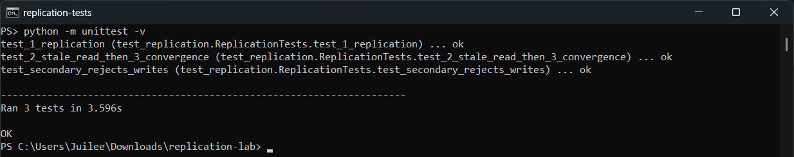
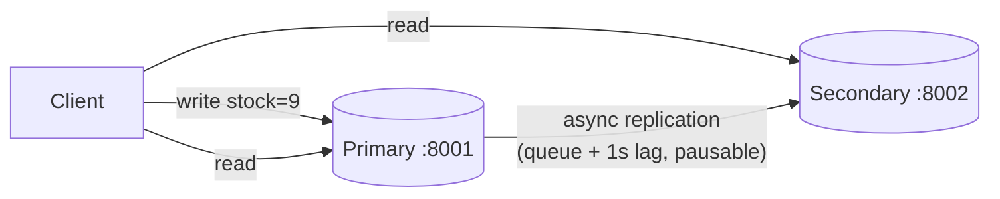
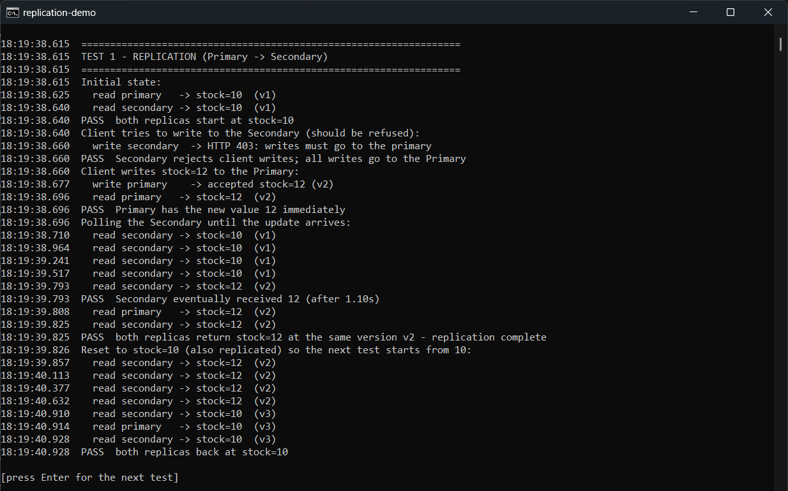
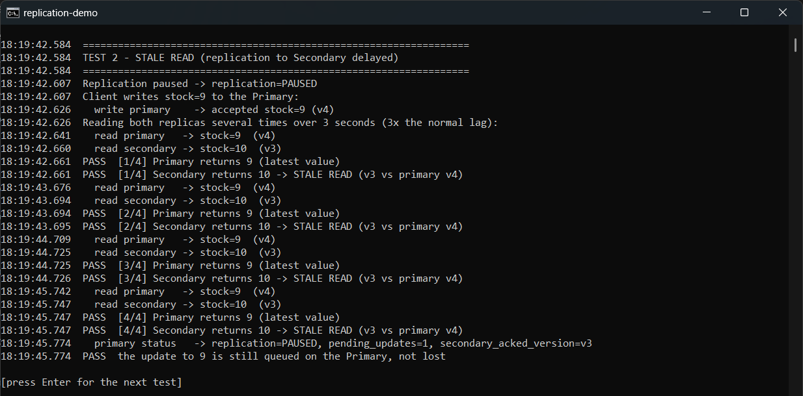
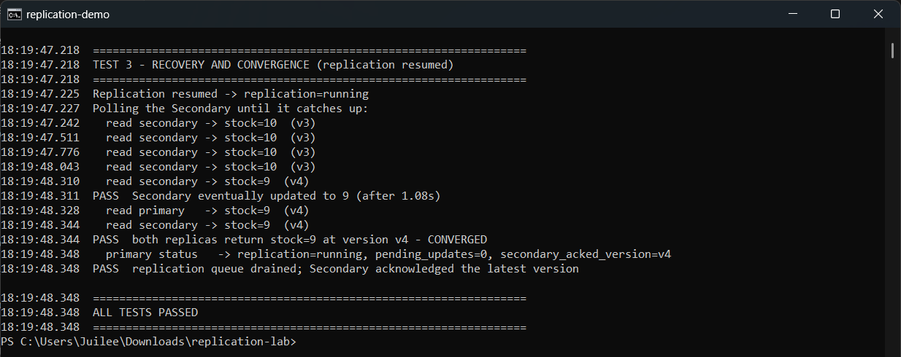

# Replication, Stale Reads, and Recovery

A small replicated inventory system in Python: one **Primary** replica, one **Secondary** replica, and a **client** that can read from either. Each replica runs as its own HTTP server process. Writes go to the Primary and are then copied to the Secondary in the background.

The demo shows three things:

1. **Replication:** a write to the Primary reaches the Secondary, and both end up with the same value.
2. **Stale read:** with replication to the Secondary paused, the Primary moves from `stock = 10` to `stock = 9` but the Secondary still returns `10`.
3. **Recovery and convergence:** when replication resumes, the Secondary updates to `9` and both replicas agree again.

## Requirements checklist

| Requirement | Where it is shown |
| --- | --- |
| 1 Primary, 1 Secondary, client reads from either | [`replica.py`](replica.py), [`client.py`](client.py), [Architecture](#architecture) |
| Updates written to the Primary, then sent to the Secondary | [How it works](#how-it-works), Test 1 (the Secondary also refuses direct writes) |
| **1.** Primary gets the new value | [Test 1](#test-1--replication): `read primary -> stock=12` right after the write |
| **1.** Secondary eventually gets the same value | [Test 1](#test-1--replication): Secondary polled `10, 10, 10, 10, 12` |
| **1.** Both return the same value after replication | [Test 1](#test-1--replication): both `stock=12 (v2)` |
| **2.** Replication to the Secondary delayed | [Test 2](#test-2--stale-read): `Replication paused -> replication=PAUSED` |
| **2.** Primary updated 10 → 9 and returns `9` | [Test 2](#test-2--stale-read): `read primary -> stock=9 (v4)` four times |
| **2.** Secondary still returns the old `10` (stale read) | [Test 2](#test-2--stale-read): `read secondary -> stock=10 (v3)` four times over 3 s |
| **3.** Replication resumed | [Test 3](#test-3--recovery-and-convergence): `Replication resumed -> replication=running` |
| **3.** Secondary eventually updates to `9` | [Test 3](#test-3--recovery-and-convergence): Secondary polled `10, 10, 10, 10, 9` |
| **3.** Both return the same value again | [Test 3](#test-3--recovery-and-convergence): both `stock=9 (v4)` – `CONVERGED` |
| Run instructions | [How to run](#how-to-run) |
| Architecture diagram | [Architecture](#architecture) |
| Screenshots, logs, terminal output | [`screenshots/`](screenshots), [`logs/`](logs), and inline below |
| Reflection (3–5 sentences) | [Reflection](#reflection) |

## How to run

Requires **Python 3.9+** and nothing else (standard library only). Ports **8001** and **8002** must be free.

```bash
git clone <this repo>
cd <repo folder>
```

### Option A: Automated demo (one command)

```bash
python demo.py
```

This starts the Primary and Secondary as two separate processes, runs all three tests, checks every expected value (it stops with `FAIL` if anything is wrong), then shuts both replicas down. Add `--step` to clear the screen before each test and wait for Enter after it. The screenshots below were taken in that mode.

```bash
python demo.py --step
```

The output is written to:

| File | Contents |
| --- | --- |
| `logs/demo.log` | Client-side output of the demo (what the terminal shows) |
| `logs/primary.log` | Server log of the Primary: writes, queueing, pause/resume, acknowledgements |
| `logs/secondary.log` | Server log of the Secondary: reads served and replicated updates applied |

### Option B: Run it by hand in three terminals

```bash
# Terminal 1 – Secondary
python replica.py --role secondary --port 8002

# Terminal 2 – Primary (replicates to the Secondary with a 1 s simulated network lag)
python replica.py --role primary --port 8001 --peer http://127.0.0.1:8002 --delay 1.0

# Terminal 3 – client
python client.py read both        # both replicas: stock=10
python client.py write 12         # replication test
python client.py read both        # run again after ~1 s: both 12
python client.py write 10         # back to 10

python client.py pause            # stale-read test: stop replication
python client.py write 9
python client.py read both        # primary 9, secondary 10  <- stale read
python client.py status           # pending_updates: 1

python client.py resume           # recovery
python client.py read both        # after ~1 s: both 9
```

Example output from this manual flow:

```
$ python client.py read both
primary   stock=10  (version v1)
secondary stock=10  (version v1)
$ python client.py pause
replication is now PAUSED (pending updates: 0)
$ python client.py write 9
primary   accepted write: stock=9 (version v2)
$ python client.py read both
primary   stock=9  (version v2)
secondary stock=10  (version v1)
$ python client.py status
primary   {"replica": "primary", "stock": 9, "version": 2, "replication": "PAUSED", "pending_updates": 1, "secondary_acked_version": 1, "replication_delay_s": 1.0}
secondary {"replica": "secondary", "stock": 10, "version": 1}
$ python client.py resume
replication is now running (pending updates: 1)
$ python client.py read both
primary   stock=9  (version v2)
secondary stock=9  (version v2)
```

### Unit tests

```bash
python -m unittest -v
```

The tests start their own replica pair on ports 8101/8102 and check the same three requirements.



## Architecture

```
                         writes (POST /stock)
        +----------+  ---------------------------->  +------------------------------+
        |          |                                 |  PRIMARY  :8001              |
        |          |  reads  (GET /stock)            |  stock=10, version=v1        |
        |          |  <--------------------------->  |                              |
        |  CLIENT  |                                 |  write -> apply locally,     |
        | client.py|                                 |  version++, put on queue     |
        |          |                                 |        |                     |
        |          |  pause / resume (admin)         |  [ replication queue ]       |
        |          |  ---------------------------->  |        |  replication thread |
        |          |                                 |        |  (1 s lag, can be    |
        |          |                                 |        |   PAUSED)            |
        |          |                                 +--------|---------------------+
        |          |                                          |
        |          |                                          |  POST /replicate
        |          |                                          |  {stock, version}
        |          |                                          v  (retried until acked)
        |          |  reads  (GET /stock)            +------------------------------+
        |          |  <--------------------------->  |  SECONDARY  :8002            |
        |          |                                 |  read-only for clients       |
        |          |  writes -> 403 Forbidden        |  applies update only if      |
        |          |  ---------------------------->  |  version > current version   |
        +----------+                                 +------------------------------+
```



## How it works

| Part | Behaviour |
| --- | --- |
| **Primary** ([`replica.py`](replica.py)) | Accepts `POST /stock`. Applies the write at once, bumps a version number (`v1`, `v2`, ...), and puts `{stock, version}` on a replication queue. It answers the client straight away, before the Secondary has the value (asynchronous replication). |
| **Replication thread** | Takes updates off the queue in order. It waits `--delay` seconds (default 1.0) to simulate network lag, then sends `POST /replicate` to the Secondary and retries until it gets an acknowledgement. While replication is **paused** (`POST /admin/pause`), it holds the update and sends it after `POST /admin/resume`. |
| **Secondary** | Serves reads from its own copy. Rejects client writes with `403`. Applies a replicated update only if its version is newer than the one it has, so retries or duplicates cannot roll it back. |
| **Client** ([`client.py`](client.py)) | `read primary`, `read secondary`, `read both`, `write N` (always to the Primary), `pause`, `resume`, `status`. |
| **Status** | `GET /status` on the Primary shows `replication` (running/PAUSED), `pending_updates` (written but not yet acknowledged by the Secondary), and `secondary_acked_version`. |

**The stale read:** the Primary acknowledges a write before the Secondary has it. Any read sent to the Secondary in that window gets the old value. Pausing replication makes the window last as long as we want, so the stale read is easy to see. In the demo it lasts more than 3 seconds, three times the normal 1-second lag.

## Evidence

All output below comes from one real run of `python demo.py --step` (the same run that produced the screenshots and the files in [`logs/`](logs)). The `vN` next to each value is the version, so you can see exactly which write a replica has applied.

### Test 1 – Replication



```
18:19:38.615  TEST 1 - REPLICATION (Primary -> Secondary)
18:19:38.615  Initial state:
18:19:38.625    read primary   -> stock=10  (v1)
18:19:38.640    read secondary -> stock=10  (v1)
18:19:38.640  PASS  both replicas start at stock=10
18:19:38.640  Client tries to write to the Secondary (should be refused):
18:19:38.660    write secondary  -> HTTP 403: writes must go to the primary
18:19:38.660  PASS  Secondary rejects client writes; all writes go to the Primary
18:19:38.660  Client writes stock=12 to the Primary:
18:19:38.677    write primary    -> accepted stock=12 (v2)
18:19:38.696    read primary   -> stock=12  (v2)
18:19:38.696  PASS  Primary has the new value 12 immediately
18:19:38.696  Polling the Secondary until the update arrives:
18:19:38.710    read secondary -> stock=10  (v1)
18:19:38.964    read secondary -> stock=10  (v1)
18:19:39.241    read secondary -> stock=10  (v1)
18:19:39.517    read secondary -> stock=10  (v1)
18:19:39.793    read secondary -> stock=12  (v2)
18:19:39.793  PASS  Secondary eventually received 12 (after 1.10s)
18:19:39.808    read primary   -> stock=12  (v2)
18:19:39.825    read secondary -> stock=12  (v2)
18:19:39.825  PASS  both replicas return stock=12 at the same version v2 - replication complete
18:19:39.826  Reset to stock=10 (also replicated) so the next test starts from 10:
          ...   (secondary polled 12, 12, 12, 12, then 10)
18:19:40.914    read primary   -> stock=10  (v3)
18:19:40.928    read secondary -> stock=10  (v3)
18:19:40.928  PASS  both replicas back at stock=10
```

The server logs show the same events from the replicas' side:

```
# logs/primary.log
18:19:38.675 [PRIMARY  ] WRITE   stock 10 -> 12 (v2) applied on primary
18:19:38.675 [PRIMARY  ] QUEUE   v2 queued for replication (replication=running)
18:19:39.719 [PRIMARY  ] REPL    v2 (stock=12) acknowledged by secondary

# logs/secondary.log
18:19:38.658 [SECONDARY] REJECT  client write refused - secondary is read-only
18:19:39.717 [SECONDARY] REPL-IN stock 10 -> 12 (v2) applied on secondary
```

### Test 2 – Stale read



```
18:19:42.584  TEST 2 - STALE READ (replication to Secondary delayed)
18:19:42.607  Replication paused -> replication=PAUSED
18:19:42.607  Client writes stock=9 to the Primary:
18:19:42.626    write primary    -> accepted stock=9 (v4)
18:19:42.626  Reading both replicas several times over 3 seconds (3x the normal lag):
18:19:42.641    read primary   -> stock=9  (v4)
18:19:42.660    read secondary -> stock=10  (v3)
18:19:42.661  PASS  [1/4] Primary returns 9 (latest value)
18:19:42.661  PASS  [1/4] Secondary returns 10 -> STALE READ (v3 vs primary v4)
18:19:43.676    read primary   -> stock=9  (v4)
18:19:43.694    read secondary -> stock=10  (v3)
18:19:43.694  PASS  [2/4] Primary returns 9 (latest value)
18:19:43.695  PASS  [2/4] Secondary returns 10 -> STALE READ (v3 vs primary v4)
18:19:44.709    read primary   -> stock=9  (v4)
18:19:44.725    read secondary -> stock=10  (v3)
18:19:44.725  PASS  [3/4] Primary returns 9 (latest value)
18:19:44.726  PASS  [3/4] Secondary returns 10 -> STALE READ (v3 vs primary v4)
18:19:45.742    read primary   -> stock=9  (v4)
18:19:45.747    read secondary -> stock=10  (v3)
18:19:45.747  PASS  [4/4] Primary returns 9 (latest value)
18:19:45.747  PASS  [4/4] Secondary returns 10 -> STALE READ (v3 vs primary v4)
18:19:45.774    primary status   -> replication=PAUSED, pending_updates=1, secondary_acked_version=v3
18:19:45.774  PASS  the update to 9 is still queued on the Primary, not lost
```

```
# logs/primary.log
18:19:42.606 [PRIMARY  ] ADMIN   replication to secondary PAUSED
18:19:42.624 [PRIMARY  ] WRITE   stock 10 -> 9 (v4) applied on primary
18:19:42.626 [PRIMARY  ] QUEUE   v4 queued for replication (replication=PAUSED)
18:19:42.626 [PRIMARY  ] REPL    paused - holding v4 until replication resumes
18:19:42.640 [PRIMARY  ] READ    client read stock=9 (v4)

# logs/secondary.log
18:19:42.658 [SECONDARY] READ    client read stock=10 (v3)
18:19:43.693 [SECONDARY] READ    client read stock=10 (v3)
18:19:44.724 [SECONDARY] READ    client read stock=10 (v3)
18:19:45.745 [SECONDARY] READ    client read stock=10 (v3)
```

For the same 3 seconds, a client asking the Primary sees `9` and a client asking the Secondary sees `10`. The Secondary is serving a value that has already been overwritten. That is a **stale read**.

### Test 3 – Recovery and convergence



```
18:19:47.218  TEST 3 - RECOVERY AND CONVERGENCE (replication resumed)
18:19:47.225  Replication resumed -> replication=running
18:19:47.227  Polling the Secondary until it catches up:
18:19:47.242    read secondary -> stock=10  (v3)
18:19:47.511    read secondary -> stock=10  (v3)
18:19:47.776    read secondary -> stock=10  (v3)
18:19:48.043    read secondary -> stock=10  (v3)
18:19:48.310    read secondary -> stock=9  (v4)
18:19:48.311  PASS  Secondary eventually updated to 9 (after 1.08s)
18:19:48.328    read primary   -> stock=9  (v4)
18:19:48.344    read secondary -> stock=9  (v4)
18:19:48.344  PASS  both replicas return stock=9 at version v4 - CONVERGED
18:19:48.348    primary status   -> replication=running, pending_updates=0, secondary_acked_version=v4
18:19:48.348  PASS  replication queue drained; Secondary acknowledged the latest version

18:19:48.348  ALL TESTS PASSED
```

```
# logs/primary.log
18:19:47.225 [PRIMARY  ] ADMIN   replication to secondary RESUMED
18:19:47.225 [PRIMARY  ] REPL    resumed - sending held v4
18:19:48.229 [PRIMARY  ] REPL    v4 (stock=9) acknowledged by secondary

# logs/secondary.log
18:19:48.228 [SECONDARY] REPL-IN stock 10 -> 9 (v4) applied on secondary
18:19:48.309 [SECONDARY] READ    client read stock=9 (v4)
```

The update held during the pause was not lost. Once replication resumed it reached the Secondary after the 1-second lag, and both replicas now return `stock=9` at the same version `v4`.

## Project files

| File | Purpose |
| --- | --- |
| [`replica.py`](replica.py) | Primary/Secondary replica server (HTTP, replication queue and thread, pause/resume) |
| [`client.py`](client.py) | Client CLI and helper functions used by the demo and tests |
| [`demo.py`](demo.py) | Starts both replicas and runs Tests 1–3 with checks |
| [`test_replication.py`](test_replication.py) | `unittest` tests for the same requirements |
| [`logs/`](logs) | `demo.log`, `primary.log`, `secondary.log` from the run shown above |
| [`screenshots/`](screenshots) | Terminal screenshots of that run and of the unit tests |

## Reflection

**What tradeoff exists between reading quickly from a replica and guaranteeing that the reader sees the latest value?**

Reading from a nearby replica is fast and spreads load away from the Primary. But with asynchronous replication, that replica can be behind, and in Test 2 the Secondary returned `stock=10` for over 3 seconds after the Primary had `9`. To guarantee the latest value, the reader has to read from the Primary or wait for replicas to confirm the write. Either choice adds latency, puts more load on one node, and lowers availability when a replica is slow or cut off, which is the CAP/PACELC tradeoff between consistency and latency. For inventory, a slightly stale count is usually fine for browsing a product page, but checkout should read from the Primary so it never sells stock that is already gone.
